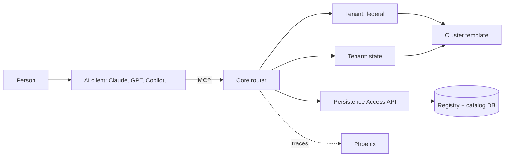

# MCP SaaS Demo (hackathon submission)

> Version 1.0 · Updated 2026-11-21 · Start here  
> [Quickstart](QUICKSTART.md) · [Documentation index](docs/README.md)

A provider-agnostic **MCP SaaS** prototype submitted to a government MCP hackathon. It makes already-public government program information usable by AI agents: a person describes their situation, an agent discovers programs across federal and state sources, screens them against source-backed criteria, and produces a cited application-readiness binder (steps, forms, documents, deadlines, who to contact).

**MCP SaaS is a platform, not a single MCP server.** Installing the MCP SaaS Core (Layer 0) lets an organization design pattern clusters, onboard tenants and register standalone MCP servers, so a fleet of MCP servers is governed and managed in one place instead of sprawling. This repository demonstrates it with two proofs: an **eligibility pattern** that gives people AI access to public program data, and the **platform** that governs it. See [docs/ARCHITECTURE.md](docs/ARCHITECTURE.md).

All demo data is **public government data** and **synthetic applicant profiles**. Nothing here uses real personal information.

## What is in this repository

| Layer | What it does | Where |
|---|---|---|
| **Core** | A thin MCP router. It resolves a user goal to a registered route and dispatches it. It holds no program logic. | `src/example_server/core_*.py` |
| **Cluster templates** | Reusable, versioned patterns that define the operations for a kind of problem (for example eligibility screening, or a simple directory). | `configs/templates/` |
| **Tenants** | An organization's own catalog, sources and policy, configured against a template. No forks of the server. | `configs/eligibility/`, `configs/registry/` |
| **Persistence** | Durable storage for the catalog, rule sets and audit. Any method that persists the data fits the design. In the demonstration it is PostgreSQL behind a Persistence Access API, a compensating component added because the assigned environment blocked direct database connections. | `deploy/local/vm-data-api/` |
| **Navigator** | The cluster's program-navigation service (discover, ask, evaluate, explain), and a web app built on it: guided demo, direct search "Test Drive", read-only operator views, and model-backed chat. | The eligibility cluster (`src/clusters/`). The web app is a test fixture and is not part of this submission; see [docs/NAVIGATOR.md](docs/NAVIGATOR.md) |
| **Evaluation** | Test questions, synthetic personas, machine suites and recorded runs. | `eval/` |
| **Deployment bindings** | Container-based deployment for the environment provided, plus agent instructions. Nothing in the platform depends on one provider. | `deploy/`, `AGENTS.md` |

Eligibility is the first full cluster, proving the pattern. The platform itself is pattern-neutral: `configs/templates/sample-directory.v1.json` is a second, minimal cluster, and copying it is the way to add your own.

## Try it

See **[QUICKSTART.md](QUICKSTART.md)**. In short: install with `uv`, run the tests, and run the local smoke test that starts a Core and two synthetic tenants and routes a request through each.

## Documentation

Start with the [documentation index](docs/README.md). The main documents:

- [Architecture](docs/ARCHITECTURE.md): vision, enterprise design, the demonstration and the pathway to scale
- [Eligibility pattern](docs/ELIGIBILITY-PATTERN.md): why this pattern, the use cases, the user journey, testing and the demo
- [Data and sources](docs/DATA-AND-SOURCES.md): how public sources become searchable, and namespaces and rule sets
- [Connecting agents and clients](docs/CONNECT.md) and Deployment
- [Evaluation](docs/EVALUATION.md): the test and validation framework, what is tested, how to run
- [How it was built](docs/DEVELOPMENT.md): the AI team, the human team and the method
- Add your own pattern

## Status and honesty about scope

This is a hackathon prototype. Production-grade multi-tenant SaaS capabilities (authentication, quotas, billing, high availability) are roadmap items unless a document states they are implemented and tested. **Persistence is a known compromise.** The design treats persistence as a capability: any method that durably stores the data fits, and at scale the platform would use native database services with direct, role-scoped connections. The demonstration does not do that. The assigned environment blocked direct database connections, so a Persistence Access API was added as a compensating control, with PostgreSQL behind it. Rebuilding the data layer into the data-agnostic, native-service model was a planned enhancement that did not fit the hackathon build window, so the demonstration keeps the compensating design. [Architecture](docs/ARCHITECTURE.md) describes the trade-off.

Evaluation output in `eval/` is regenerated for each release; check the date on any result before relying on it.

## AI assistance

This project could not have been built without AI. Several AI tools were used in defined roles, in parallel, under human direction, with human review and acceptance of the design and every change. Agent behavior is scored with an evaluation harness rather than assumed. See [How it was built](docs/DEVELOPMENT.md).

## Components and provider neutrality

See [COMPONENTS.md](COMPONENTS.md) and [docs/PROVIDER-NEUTRALITY.md](docs/PROVIDER-NEUTRALITY.md).

## Credits

Architecture, code and design by Mike Puntumapanitch. Contributors: Gary Paxson, Stephanie Mora and Paul Whitfield. See [CREDITS.md](CREDITS.md). Terms of this submission: [SUBMISSION-NOTE.md](SUBMISSION-NOTE.md).

---

[Quickstart](QUICKSTART.md) · [Documentation index](docs/README.md)
