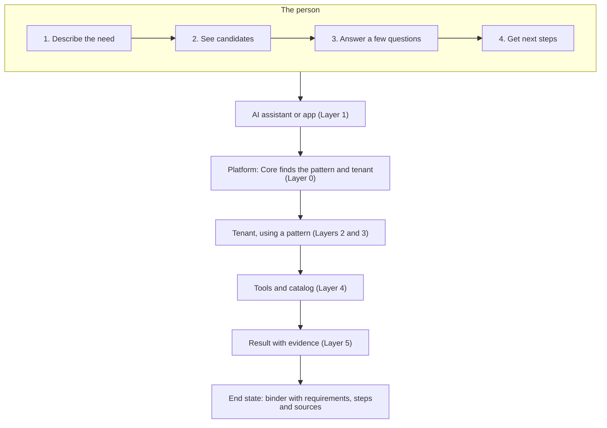
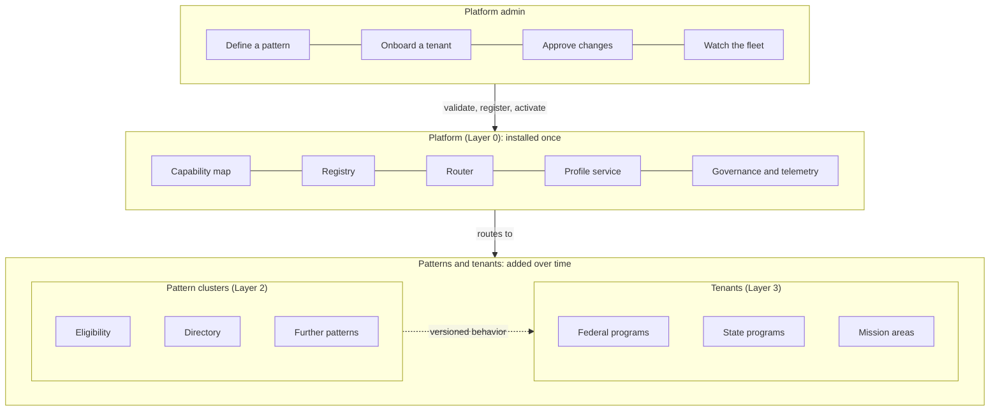
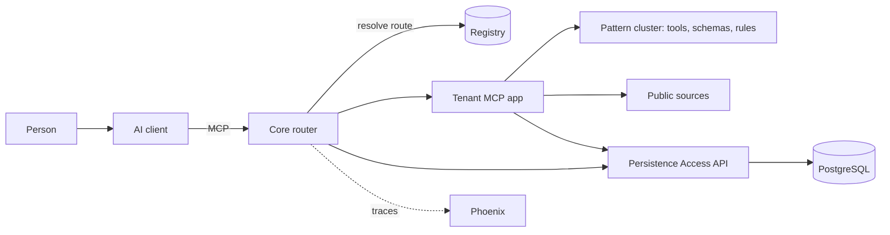

# Architecture

> Version 1.0 · Updated 2026-11-21 · Reading order 1 of 7  
> [Documentation index](README.md) · [Next: How the use cases led to the design](USE-CASES.md)

This document has four parts, in the order the work happened.

1. [**Vision and design intent**](#part-1-vision-and-design-intent): what the platform is for and the rules it follows.
2. [**Enterprise design**](#part-2-enterprise-design): the target architecture, designed to scale.
3. [**Demonstration**](#part-3-demonstration-proof-of-concept-and-proof-of-value): the enterprise design collapsed into a working proof of concept and proof of value in the environment we were given, and the compromises that required.
4. [**Pathway to scale**](#part-4-pathway-to-scale): how each compromise should be undone in a real deployment.

Related documents: [Eligibility pattern](ELIGIBILITY-PATTERN.md), [Data and sources](DATA-AND-SOURCES.md), [Connecting agents](CONNECT.md), [Evaluation](EVALUATION.md), and the [order of operations](OPERATING-ORDER.md).

---

## Part 1: Vision and design intent

### Purpose

Two problems sit in front of government today. First, people cannot get AI access to public data that is spread across many agency sites, so a person cannot easily find the programs they qualify for. Second, MCP is the way to give AI that access, but using it effectively and innovatively is still hard. Solving those two creates a third problem, the one every new technology creates when it scales: sprawl. Every team stands up its own MCP server, and the result is duplicated work, inconsistent standards, weak governance, silos, cost overruns and poorly used infrastructure. Government then has to rein it in after the fact.

This project solves all three in one demonstration, with two proofs.

- **Proof 1, the pattern.** An eligibility pattern answers "what do I qualify for, and what do I need?" with cited, source-backed results and an application-readiness binder. It proves that AI access to public data for everyone works, and it is what the hackathon judges most directly.
- **Proof 2, the platform.** The MCP SaaS Core, which is Layer 0, proves the enterprise answer: a governed way to build, onboard and manage many MCP servers instead of letting them sprawl.

**The platform is not an MCP server.** MCP SaaS is both a product and a layer. When an organization installs the MCP SaaS Core (Layer 0), it gets the capability to design and build pattern clusters, to onboard and manage tenants, and to register standalone MCP servers beside them, so a whole fleet of MCP servers is managed in one place. Because the platform sees every cluster, tenant and server, it can manage cost, utilization, load and value across the fleet. Those management capabilities are part of the design: consolidating duplicate servers, isolating load, optimizing, and retiring or promoting servers by the value they deliver, together with FinOps and reporting. The demonstration implements the registry, routing, lifecycle governance and telemetry foundations of this and does not scale the fleet-optimization features. Part 4 says what is built and what is not.

The ideas behind the platform:

- **Built once, reused everywhere.** The platform is installed once. New patterns and tenants are added without architectural rework.
- **Patterns are the building blocks.** A *pattern cluster* captures a recurring kind of problem (eligibility screening, document retrieval, analytics) with its tools, schemas and rules.
- **Tenants are lightweight.** A tenant binds a pattern to one organization's sources, catalog, criteria and policy, with no fork of the server.
- **Any client can connect.** Direct MCP is first class; adapters extend access to channels that cannot speak MCP.
- **Registry-driven routing and governance.** Registrations, not code, decide where a request goes, and every lifecycle change is reviewed.
- **Portable.** Containers and documented contracts, not a provider SDK.

The platform rests on one rule: **tools hold the logic and the catalog holds the context.** A pattern's tools are written and tested once. Differences between tenants are expressed in catalog data, criteria and policy, never in tool code. Clusters provide structure; tenants provide context.

Eligibility is the first full pattern. A second, minimal Directory pattern shows the platform itself is not eligibility-specific.

### How we arrived at this design

The design came from working a problem up, from one use case to an industry-wide issue.

1. **Find good MCP use cases.** Research identified 49 high-value USDA use cases, spread across the mission areas and their divisions.
2. **Narrow them with the rules.** The hackathon guidelines prohibited production, internal and sensitive data (public data only) and any access to production systems, including writes. That removed many candidates and left use cases that run on public data without touching production.
3. **Find the patterns underneath.** Looking at the use cases individually, about 15 core pattern templates sat underneath all 49. The use cases related to those patterns one to one, one to many, or many to one. Each use case was classified and mapped to a pattern.
4. **Choose what to build.** Everyone asked which single use case to build. Mapping to patterns changed the question to which pattern to build first, and what it would take to scale it.
5. **Meet the governance problem.** Building one pattern and then adding mission areas to it creates governance, cost and tool-collection problems: duplicated tools, inconsistent standards and unmanaged growth. The question became whether a cluster of tenants sharing a pattern could be managed, and whether a set of patterns, each with its own tenants, could be managed as well.
6. **Name the model.** That is the same pattern the software-as-a-service model solved in an earlier era. The industry is developing independent MCP solutions today, so the research led to MCP SaaS: a platform that is pattern-agnostic and manages a fleet of tenants and MCP servers.

This is one way to solve the problem, not the only way. What distinguishes it is that it costs little, needs no vendor lock-in, and runs independently of any provider, on one provider or across several. The novel part is control, governance, scale and adaptability to a local organization or enterprise.

### Design principles

1. **A thin, stable front door.** Core exposes a small set of tools and routes everything else through one dispatch tool, `route_operation`. Adding a pattern or tenant changes registered data, not the tool list a client sees, so clients and prompts do not break when the catalog grows.
2. **Progressive discovery.** A client starts with `describe_core_capabilities`, lists routes with `list_core_routes`, reads an operation's input schema with `read_cluster_schema`, then calls it. Each step returns only what the next one needs, which keeps context small for the agent.
3. **Typed contracts.** Every operation has a versioned input schema and a result contract. Results use explicit outcomes (`met`, `unmet`, `unknown`, `not_applicable`) rather than prose, so a missing fact is reported as missing and never guessed.
4. **Evidence with every answer.** Results carry source identity, URL, retrieval time and any limitation. A program listing and machine-evaluable criteria are reported separately, so a found program is never presented as a screened one.
5. **Read by default, write by exception.** Routing and lookups are read-only. Writes (profiles, catalog changes, publications, tenant and template lifecycle) use separate tools, separate credentials and, for operator changes, an exact-digest approval: the approver sees the digest of what will change and the write fails if the content differs.
6. **Fail closed and explain.** Unknown routes, ambiguous tenants, unavailable sources and stale revisions return a typed status and a suggested next action. The platform never silently picks a tenant or invents a result.
7. **Pattern-neutral core.** Core holds no domain rules. A pattern owns its tools, schemas and result semantics.
8. **Public data and synthetic people.** Program information comes from public government sources with provenance. Applicant profiles are synthetic. Results are informational screening, not an agency determination.
9. **Meet people where they are.** The platform asks a client for an MCP connection and a skill, so a standard AI assistant on a phone, including by voice, becomes the interface. Conversation and voice lower the barrier for everyone, and for people with disabilities they can be what makes access possible.
10. **Name the authoritative source, then point to it.** Every piece of information has one named authoritative source. Everything else is a projection of it or a pointer to it, and the same pattern is reused instead of building a new mechanism for each case. See [Authoritative source and policy as code](#authoritative-source-and-policy-as-code).

### Authoritative source and policy as code

Every piece of information has one authoritative source, and that source is named and logged. Everything else is a projection of it or a pointer to it. Git is the authoritative source only for what the team itself writes: documents, definitions, migrations and content. For public program data, the authoritative source is the public source itself. The catalog records that source's identity, its mappings and its provenance, and points to it. It does not become a second copy.

| Place | Authoritative source | What we keep | What consumers read |
|---|---|---|---|
| Public program data | The public source (an agency page, dataset or API) | Source identity, query and normalization mappings, provenance and freshness evidence in the catalog | The source itself, at request time, through the catalog's pointer |
| Eligibility criteria | The public source's published rules | A cited, versioned rule set, identified by its content digest | The active rule set, with a link back to its source |
| Platform definitions (schemas, templates) | Reviewed JSON in Git | The registered, active record in the database | Core and tenants, through the access API |
| Documents | Markdown in Git | A rendered copy stamped with version and date | A reader |
| Navigator pages and curated data | Reviewed files in Git | A read-only synced folder | The running container |

In every row, the record says where it came from, the consumer reads a projection or a pointer and not a second copy to edit, version, source and fingerprint travel with the content, and a change is a new version so a past result can still be explained.

**Stated another way: policy as code.** This principle adapts policy as code and applies it well beyond policy. A policy, rule or standard is written as a versioned, reviewable artifact, and systems evaluate or enforce it, so it is not a document that people have to remember.

- **Source policy.** Which public sources may enter discovery is a versioned manifest with a digest. An approval binds to that exact digest, and activating it changes what search may return.
- **Eligibility criteria.** A program's rules are a cited, versioned rule set that deterministic code evaluates. A language model does not decide eligibility.
- **Data contracts.** The database enforces contracts with constraints. For example, a saved requirements package is rejected if it carries a profile or claims to be an official determination.
- **Coding and documentation standards.** Lint rules and CI checks enforce them on every pull request.
- **Release gates.** A vulnerability and quota check must pass before anything is published.

Because each of these is code, each can be reviewed, versioned, tested, rolled back and explained after the fact.

**Why a pattern and not a silo.** The alternative is to solve each case on its own: one way to publish documents, another to load records, another to ship pages. That is how stovepipes form, and each new content type adds a mechanism to learn, secure and maintain. With one pattern, a new content type slots into an existing path, and what we learned about reviewing, versioning and rebuilding in one place carries to the others. It is the same reasoning as the platform itself: a pattern cluster is a reusable template, and a tenant is a configuration of it, not a fork.

Where it is applied: [Data and sources](DATA-AND-SOURCES.md) (sources, mappings, criteria and the catalog) and the [naming standard](NAMING-STANDARD.md) (platform records).

### Design vocabulary

All documents in this repository use the same terms.

| Term | Meaning | Example |
|---|---|---|
| **Architecture** | The components and the rules between them. | Core, tenants, the data service |
| **Layer** | One of six responsibilities in the architecture. | Layer 4: tools and catalogs |
| **Capability** | What the platform or a pattern can do for a user, stated as an outcome. | Discover programs across federal and state sources |
| **Feature** | A deliverable that provides part of a capability and can be released and tested on its own. | Source-backed criteria evaluation |
| **Tool** | A callable MCP surface that implements a feature. Core tools are listed in Part 3; pattern tools are routed operations. | `program.evaluate` |
| **Pattern cluster** | A reusable, versioned set of tools, schemas and rules for one kind of problem. | Eligibility, Directory |
| **Tenant** | One organization's configuration of a cluster. | A state agency's catalog and policy |

---

## Part 2: Enterprise design

The enterprise design is six layers. It is built to scale: more patterns, more tenants and more channels without re-architecture. Two views follow. The first traces one request from a person's need to the saved binder. The second separates the platform, which is installed once, from the patterns and tenants that are added over time.

**A request, end to end.** The person starts with a need and works through four steps. Their AI assistant or app carries each step to the platform, which finds the right pattern and tenant. The tenant's tools read its catalog and return a result with evidence. The end state is a binder of requirements, steps and sources, returned through the same channel the person started in.

**The platform and the patterns.** An operator manages the platform: define a pattern, onboard a tenant, approve changes and watch the fleet. The platform routes requests. Patterns and tenants sit on it and can be added without changing it.

| Layer | Responsibility |
|---|---|
| **0. Root platform** | Installed once. Template, schema, adapter, mission-area and use-case registries; a deterministic meta-router that selects pattern and tenant from registry metadata; a credential and access model with sandboxed, read-only and scoped profiles; telemetry; governance (versioning, audit, lifecycle). It stays stable and centralized so scaling to a new agency or domain is configuration, not re-architecture. |
| **1. User interaction** | Every channel through which a person, agent or application starts a request. A universal adapter layer normalizes channels that cannot use MCP directly into one request contract; direct MCP is a first-class path. |
| **2. Pattern clusters** | Reusable domain models: logic, metadata structures, schemas and tool workflows for a category of problems. Examples: eligibility, documentation retrieval, analytics, geospatial, regulatory interpretation, dataset access. |
| **3. Tenants** | A mission area's or organization's instantiation of a cluster, with its own semantics, program catalog, jurisdictional rules and data sources. One cluster supports many tenants, from national programs to state, county and tribal ones. |
| **4. Tools and catalogs** | Deterministic, reusable tools that implement the pattern, and the pattern metadata catalog they read. Tenants supply their catalog content; tool code does not change per tenant. |
| **5. Outputs** | Pattern-owned results with evidence and limitations, wrapped in a shared routing envelope. A request can ask for a tenant-specific or a cross-tenant result. |

The enterprise Eligibility tools are: ingest a program catalog, normalize a profile, search programs, compare criteria, rank matches, generate a requirements packet, get program details, compare tenants, and score confidence. Outputs are ranked programs, unmet criteria, requirements packets, citations and provenance, and a confidence score.

### Logical responsibilities and runtime units

The design separates **logical responsibilities from runtime units**. A registry, a pattern library or an adapter layer is a logical capability; it does not automatically need its own service or container. Core and tenant applications, the persistent data service and independently triggered operational writers are the runtime units, and each can be deployed on its own. This separation is what allows the enterprise design to run as a small deployment without changing any contract: the same responsibilities exist, hosted in fewer units.

### Enterprise security and data model

- **Identity.** OAuth, enterprise identity (ICAM) and a Credential and Identity Broker (CIB) service with per-user authorization, metering and quotas.
- **Data.** A durable, managed data service for registrations, catalog, profiles and telemetry that Core and tenants reach with private, role-scoped connections.
- **Least privilege.** Each runtime and job receives only the access its role needs. Secrets stay out of source, images and logs.
- **Controlled writes.** Routing and lookups read; onboarding, catalog ingestion and profile updates use separately authorized writers with explicit contracts.
- **Freshness.** Scheduled, event-triggered or operator-requested refresh runs the same bounded writer; validation precedes activation, and a failed refresh keeps the last known-good data.
- **Privacy.** Persist only approved profile fields; real-person data requires defined purpose, identity, authorization and retention controls first.

---

## Part 3: Demonstration (proof of concept and proof of value)

The enterprise design was collapsed into a demonstration that was deployed and live in 30 days, then refined and tested over the next 30. It ran in an IBM cloud sandbox, which is the environment we were given, so some controls and parts of the design were compromised to work within it. The demonstration is evidence that the design works; it is not the design.

The result is that nearly every capability was proven to work end to end, even where it was not built the way we would have preferred. The compromises below changed how a capability is hosted or protected, not whether it works.

### What was built, by layer

| Layer | Demonstrated |
|---|---|
| **0. Root platform** | Core router and one registry in the database holding templates, schemas, adapter references, tenants and routes; exact-digest operator approvals; route telemetry |
| **1. User interaction** | Direct MCP from Claude and GPT (web, mobile and voice through their apps), a Microsoft Copilot Studio agent in the USDA Teams environment, other MCP-capable agent platforms, and the Navigator app |
| **2. Pattern clusters** | Eligibility, and a minimal Directory pattern that proves reuse |
| **3. Tenants** | Tenants registered against active template versions over a shared cluster inventory spanning federal and state sources |
| **4. Tools and catalogs** | Search, discovery, criteria mapping and evaluation, requirements binder and profile tools (see [Eligibility pattern](ELIGIBILITY-PATTERN.md)) |
| **5. Outputs** | Cited criterion outcomes, requirements binder, explicit `unknown` and `mapping_required` |

### Components

| Component | Responsibility | Code |
|---|---|---|
| **Core** | MCP server. Validates a request, resolves a route, dispatches to the tenant, returns a shared response envelope. Also hosts the operator-gated lifecycle tools. | `src/example_server/core_*.py` |
| **Pattern cluster** | A versioned package of domain tools, schemas, rules and result contracts, reusable across tenants. | `src/clusters/`, `configs/templates/` |
| **Tenant** | One organization's configuration bound to a cluster version. Runs as its own MCP application. | `configs/`, `src/example_server/app.py` |
| **Persistence Access API** | The only component with database credentials. Exposes bounded HTTP routes, each checking a purpose-scoped token. A compensating component (see below). | `deploy/local/vm-data-api/` |
| **Registry and catalog database** | Routes, templates, tenants, schemas, public source and program catalog, profiles, packages, telemetry. | `db/migrations/` |
| **Profile service** | A first-class service in the cluster that holds the user's synthetic profile, its namespaced attributes and dimensions, and saved programs, so the user owns and resumes their own context. | `src/clusters/`, `db/migrations/` |
| **Navigator service** | A first-class service flow inside the cluster that navigates programs: it discovers, asks for what is missing, evaluates and explains, following the published workflows. It is part of the cluster, so every client gets it. | `src/clusters/`, workflows read through `read_core_workflow` |
| **Navigator app** | The Navigator service turned into a web app, so the service offering can be directed and demonstrated directly: guided demo, direct search "Test Drive", read-only operator views, and a model-backed chat that adds the LLM to the service. | Test fixture, not included in the submission ([details](NAVIGATOR.md)) |
| **Evaluation harness** | Machine suites, test questions, synthetic personas and recorded runs. | `eval/` |

### Core tools

- **Discover:** `describe_core_capabilities`, `list_core_routes`, `read_core_route_target`, `read_core_workflow`, `list_registered_tenants`, `list_cluster_templates`, `read_cluster_capability`, `read_cluster_schema`, `read_tenant_binding`.
- **Operate:** `route_operation` dispatches any registered operation to its tenant.
- **Profile (synthetic):** `write_profile`, `read_profile`, `resume_profile`, `create_profile_resume_claim`, `revoke_profile_resume_claim`, `set_saved_program_interest`, `preview_profile_refinement`.
- **Operator lifecycle (credential required):** template and tenant registration, activation and deactivation, source-policy review and rollout, program-candidate review and publication, catalog metadata correction, and `get_fleet_operations_report`.

### Request flow

1. The client calls `route_operation` with a route, an operation ID and arguments that match the operation's published schema.
2. Core resolves the active route in the registry. An unknown or inactive route returns a typed failure.
3. Core forwards the call to the tenant application bound to that route.
4. The tenant runs the pattern's tool. It reads the catalog through the Persistence Access API and, where the pattern requires it, reads an approved public source directly with bounded, allowlisted requests.
5. The tenant returns a pattern-owned result with evidence and limitations. Core wraps it in the shared envelope (route, status, timing).
6. Core records privacy-safe telemetry: route, status and latency, never profile values or arguments.

### Tenants, templates and the shared catalog

A *template* is a registered, versioned description of a pattern: its operations, schemas and handler bindings. A *tenant* is registered against an active template version with its own configuration.

Discovery is deliberately not limited by tenant. All approved public program records live in one **shared cluster inventory**; a tenant adds criteria, semantic mappings and workspace context on top, so a tenant's own configuration cannot hide a valid program from search. A versioned **source policy**, reviewed and activated by an operator, controls which public sources may enter the inventory (see [Data and sources](DATA-AND-SOURCES.md)). Template and tenant lifecycle is operator-only, and deactivating a template also disables the tenants and routes that depend on it.

### Sandbox constraints and how the design compensated

We used the environment we were given. It lacked three things the enterprise design needs, and each compromise is deliberate and temporary.

| Missing in the environment | What the design needed | Compensation used | Effect |
|---|---|---|---|
| A managed database and secure direct database access from the cloud | Durable state that Core and tenants reach privately | PostgreSQL in a container on a VM, reached only through the **Persistence Access API** | Adds a network hop and a component to run; justified only by the constraint |
| Enterprise identity (OAuth, ICAM, a Credential and Identity Broker) | Per-user authorization, metering, quotas | **Purpose-scoped tokens** per role and an operator credential, read from files at runtime | Zero-trust, per-purpose model with real value, but static tokens are issued and rotated by hand and carry no user identity |
| A channel-adapter layer | Universal adapters for each channel | Direct MCP plus the Navigator app, agent definitions and a Copilot Studio agent | Covers the demonstrated channels; further channels need adapters |

The purpose-scoped tokens are: registry read and write, template and tenant registry write, profile read, profile write and evaluation-fixture read, catalog read, public catalog write, requirements-package write, criteria-ruleset write and route-telemetry write.

### What the rebuild taught us

Midway through the build the development environment, including the database, was lost and rebuilt from container images and Git. That forced two design decisions that now stand. First, the repository, not the database, is the source of truth for the schema, the seed data and the mapped criteria, so the data tier can be rebuilt on demand. Second, the tenant and the cluster own the catalog fully, with controls aligned to that ownership, and the profile and the Navigator carry the enrichment that makes the AI client's answer specific to the user. See [How it was built](DEVELOPMENT.md#a-setback-and-the-rebuild).

### Controls that apply in the demonstration

- **Operator boundary.** Operator tools require an operator credential in the MCP request header and, for lifecycle changes, an exact-digest approval and a recorded reference. Standard connections can read but not change platform state.
- **Public discovery, private profiles.** Searching programs needs no identity. Reading or writing a profile needs an authorized session scope; a client cannot choose or enumerate other profiles. Profile text is untrusted data and cannot change tool permissions.
- **Bounded source access.** Source fetches accept only public HTTPS URLs without embedded credentials, validate the resolved address, follow at most a few redirects (each re-validated), apply time and size limits, and return sanitized failures.
- **No real personal data.** Profiles are synthetic. Raw prompts are not stored as runtime records.
- **Failure and freshness.** Refreshes validate before activation; a failed or partial refresh keeps the last known-good data and reports a stale or degraded state. Replayed writes are idempotent (an exact replay returns an unchanged receipt; changed content under an existing identity returns a conflict). Revisioned records use an expected-revision check so a stale write is rejected.

### What the demonstration does not implement

Per-user authentication, quotas and metering, high availability, a managed data service, the other pattern clusters, cross-tenant comparison, combined ranking and confidence scoring, and dedicated per-channel adapters. The data-platform and data-analytics channel (Databricks) was designed but not tested: its MCP connection works, but the Core's functions were not exercised from it, and the data-layer API that data tools would use for discovery was loaded with the database and datasets but not connected to a data-tool front end or tested.

---

## Part 4: Pathway to scale

This is how each compromise should be undone in a real deployment. Every row keeps the layer boundary and the contract from Part 2, so the demonstration's patterns, tools and results carry over.

| Concern | Demonstrated | How it should be done |
|---|---|---|
| **Data service** | PostgreSQL container on a VM behind the Persistence Access API | A managed database with private networking and direct, role-scoped connections from Core and tenants. Retire the Persistence Access API: a remote data API is inefficient except where direct secure access is unavailable. |
| **Identity and access** | Open standard access by design (public data only), static purpose-scoped tokens and an operator credential on the sensitive functions | OAuth, enterprise identity (ICAM) and a Credential and Identity Broker (CIB) service with per-user authorization. Any data set or tool that needs access control gets it the same way the operator functions are controlled in the demonstration. Keep least privilege per role, enforced as identity roles and database grants, and keep the exact-digest approvals. |
| **Registries** | One registry in the database | Split registries, or a managed registry service, without changing route or template contracts |
| **Channels** | Direct MCP, the Navigator app, agent definitions, a Copilot Studio agent. The original universal adapter layer was collapsed into this one standard connection | The adapter layer as designed: a simple, streamable, load-balanced and optimized adapter per channel over the same request contract |
| **Data platforms and analytics** | Designed; the MCP connection works, functions and the data-layer discovery API not exercised | A data connector with controlled access to N tenant and pattern catalogs of source data and normalized, mapped metadata. It shifts ingestion and discovery from individual analysts to the platform, following extract, load and transform best practice |
| **Patterns** | Eligibility and a minimal Directory | Register new templates (documentation retrieval, analytics, geospatial, regulatory, dataset access); the platform does not change |
| **Tenants** | A shared inventory with tenants configured over it | Per-mission-area, state, county and tribal tenants with their own catalogs, and cross-tenant comparison |
| **Tools and outputs** | Per-criterion outcomes with evidence | Ranking, a confidence model and cross-tenant outputs added to the pattern |
| **Operations** | Single instances | Multi-instance Core, automated recovery, quotas and metering on top of enterprise identity |

## Where the decisions are recorded in code

- Route, template and tenant registries: `src/example_server/core_routes.py`, `core_templates.py`, `core_tenants.py`.
- Source policy and candidate promotion: `src/example_server/core_source_policy.py`, `deploy/local/vm-data-api/source_policy_manifests.py`, `program_candidate_publications.py`.
- Profile handling: `src/example_server/core_profiles.py`.
- Telemetry and tracing: `src/example_server/core_telemetry.py`, `core_tracing.py`.
- Schema and migrations: `db/migrations/`.

---

[Documentation index](README.md) · [Next: How the use cases led to the design](USE-CASES.md)
