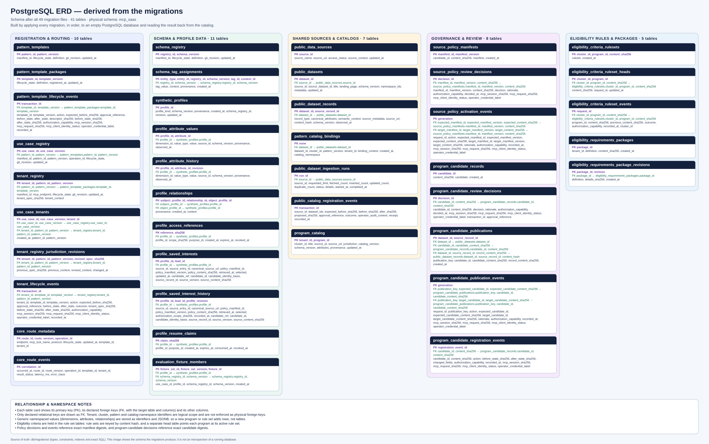
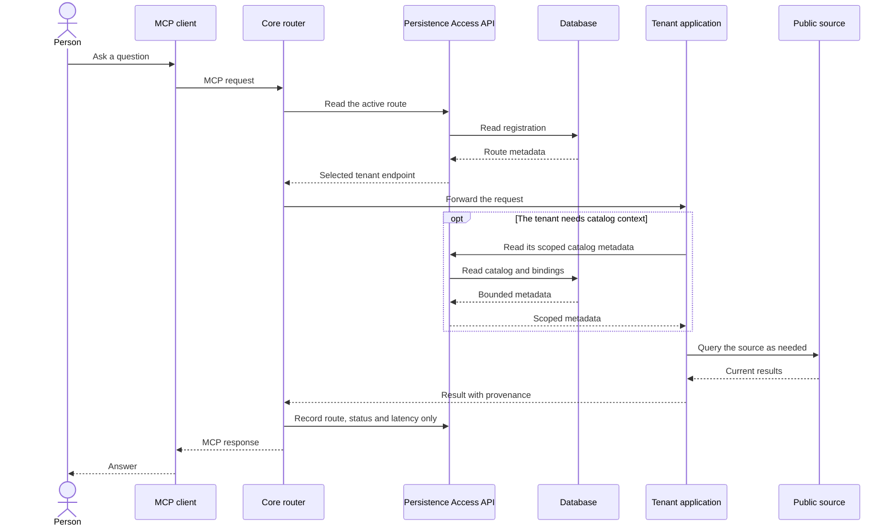
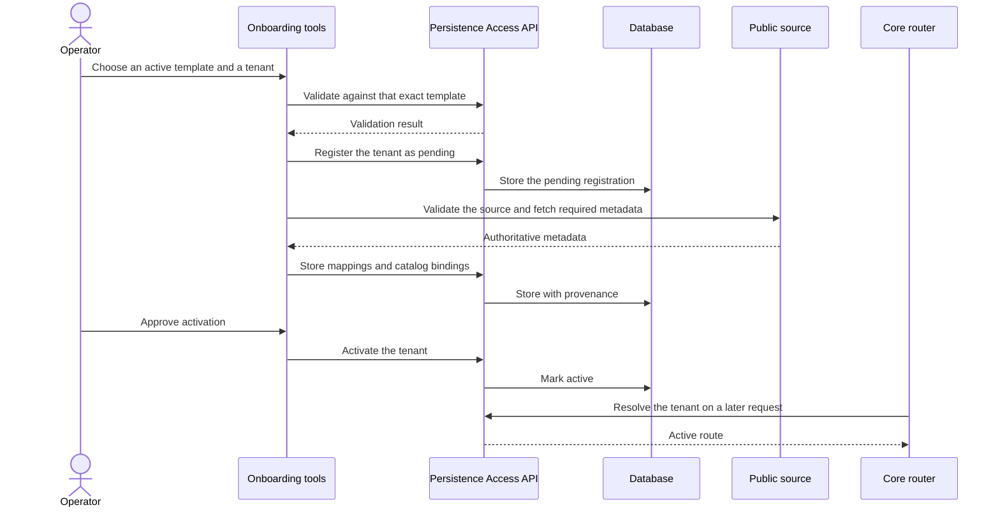
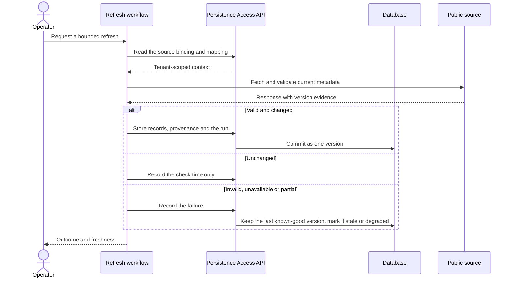

# Data and sources

> Version 1.0 · Updated 2026-11-21 · Reading order 4 of 7  
> [Previous: Eligibility pattern](ELIGIBILITY-PATTERN.md) · [Documentation index](README.md) · [Next: Connecting agents and clients](CONNECT.md)

How the platform stores what it needs, how public sources are approved and kept fresh, and what it never copies. This is the data design. How it was hosted in the demonstration is in the last section, and how it should be hosted at scale is in [Architecture, Part 4](ARCHITECTURE.md#part-4-pathway-to-scale).

## Principles

- **Git versions the design, a data service holds the runtime.** Source code, contracts, migrations, fixtures and releases live in Git. Live registrations, catalog metadata, profiles and telemetry live in a durable data service, so they survive restarts and can change without a release.
- **The authority keeps its records.** The catalog holds source and dataset identity, mappings, rules, provenance and freshness evidence. It does not mirror complete upstream datasets. Request-time reads fetch only what a request needs and discard the transient payload.
- **Pattern-neutral storage, pattern-owned meaning.** The platform stores generic pattern, tenant, source and catalog records. Each pattern template declares its own catalog namespace and entity meanings; Eligibility's catalog is called `programs`.
- **Identity before meaning.** A source is identified by a stable identity, not by a title or a field name. A matching name does not prove two records mean the same thing.
- **Controlled writes.** Ordinary requests read. Registration, ingestion, profile and migration writes use separately authorized paths, and no request handler holds more than one of them.

These principles apply the [authoritative-source principle](ARCHITECTURE.md#authoritative-source-and-policy-as-code): the public source is authoritative for program data, and the catalog points to it.

## What is stored

| Group | Holds | Written by |
|---|---|---|
| **Registry** | Routes, pattern templates and versions, tenant registrations, schemas, schema tags | Operator lifecycle tools |
| **Public sources and inventory** | Source and dataset identity, query and normalization mappings, program records with jurisdiction and criteria status, freshness evidence | Governed catalog registration and publication |
| **Criteria** | Typed, cited rulesets per program, with source lineage | Criteria persistence |
| **Requirements packages** | Saved, revisioned application-readiness binders | The screening write path |
| **Synthetic profiles** | Approved profile fields and relationships, saved program interests, resume claims | Profile tools, after confirmation |
| **Governance records** | Source-policy candidates and review decisions, activation events, program-candidate review and publication records, lifecycle audits | Operator tools, append-only |
| **Telemetry** | Route, status and latency per call, with no arguments or profile values | Core |

The schema is built by 49 ordered migrations in `db/migrations/`. Each migration is a reviewed, structural change; none runs from an ordinary request.

## Data flows

Three flows show how the boundary works. They describe the system as deployed for the demonstration, not the at-scale design. In every one, the Persistence Access API is the only thing that talks to the database. Core and tenants never connect to it, and an ordinary request only reads.

### Answering a request

The router and the tenant hold read access only. The one write on this path is telemetry, which stores the route, status and latency and never the arguments or profile values. The catalog holds metadata and mappings, so the answer comes from the public source at request time and not from a copy.

### Onboarding a tenant

A tenant is pending until an operator activates it, and only an active tenant can be routed to. Registration and activation use a registry writer credential that Core does not hold. Templates follow the same path: validate, register as pending, then activate. Deactivating a template or tenant switches off its routes without deleting anything.

### Refreshing source data

As deployed, an operator starts a refresh. The design allows a schedule or a trusted source event to start the same workflow, but that is not built yet. Every outcome is recorded with its trigger, so a failed refresh never hides the last good data and the person reading a result can see how fresh it is. A source reaches the shared inventory only through the review and publication flow in the next section.

## How a public source becomes searchable

Nothing enters the shared inventory just because it can be fetched. Approval is separate from retrieval, and retrieval is separate from publication.

```mermaid
%%{init: {"htmlLabels": false, "flowchart": {"htmlLabels": false, "wrappingWidth": 260, "padding": 14}, "themeVariables": {"fontSize": "13px", "fontFamily": "Arial, Helvetica, sans-serif"}}}%%
flowchart LR
  A[Source policy candidate] --> B[Operator review: approve or reject]
  B --> C[Activate policy bundle]
  C --> D[Program candidate: normalize and register]
  D --> E[Operator review]
  E --> F[Publish to shared inventory]
  F --> G[Discoverable by every tenant]
```

1. **Source policy.** A candidate policy names the public sources, domains and fields that may enter discovery, with their authority class. An operator reviews it and records an `approved` or `rejected` decision with a rationale. The decision binds to the candidate's exact content digest, so what was reviewed is what takes effect.
2. **Activation.** Activating, deactivating or rolling back a policy needs the operator credential, client-side confirmation and an exact-digest readback. Activation changes what search may return; it does not ingest anything.
3. **Program candidates.** A discovered program lead is normalized from its cited record, checked for omissions, and registered only as a pending review record. Registration neither approves nor publishes it.
4. **Review and publication.** An operator decides from the persisted candidate and its exact digest. Publication to the shared inventory requires an approved candidate and an active source policy.
5. **Discovery.** Once published, the record is searchable by every tenant. A tenant cannot hide it, and a tenant's demo fixtures do not filter it.

Each decision and lifecycle event is an append-only record. Events carry hashes of the MCP session and request identifiers, so they can be correlated with transport logs without storing raw identifiers. A shared service credential is not a human identity, and the records say so.

### Open-web discovery

When the shared inventory is thin, `program.discovery.external.search` looks for leads on the public web. Its queries are constrained by a versioned allowlist of domains, each with an authority class, and safe HTTPS results from outside the allowlist can still appear. Results are unverified leads until their source and authority are checked, and they are labeled that way in every result.

## Ingestion behavior

- **Register, don't copy.** Registering a source stores identity, access and query metadata, mapping versions, provenance and freshness outcomes, not source rows. A query-time read fetches bounded pages and normalizes only the mapped fields. For example, the health-center directory is registered with its mapping and provenance, and matched facility fields are returned at request time without copying the file into the database.
- **Bounded and allowlisted.** Fetches use public HTTPS, approved origins, size and time limits, and a small number of re-validated redirects.
- **Two hashes, two meanings.** `source_content_sha256` identifies the exact bytes fetched. A separate hash identifies the extracted visible text a rule excerpt was checked against. Normalized-record identity is separate again.
- **Explicit duplicates.** The identity `(source_id, dataset_id, source_record_id)` is checked before any write. An exact repeat is skipped and reported as `exact_duplicate_skipped`. The same identity with different content is reported as a conflict and not silently replaced. Near-duplicates across sources are flagged for review without losing either source's provenance.
- **Exceptions need a purpose.** If a projection of source data must be persisted, it needs an approved purpose, a field allowlist, an identity rule, a retention policy and a rollback path.
- **Never stored by default.** Personal or contact fields, full page bodies and raw source rows.

## Freshness

One refresh workflow serves three triggers: a schedule suited to how the source changes, a reliable source event (treated as a prompt to re-fetch and validate, not as the data), and an authorized operator request. All three run the same idempotent, tenant-scoped job and record the trigger, actor, check time, last successful ingest, source-version evidence and outcome. Cadence and stale thresholds are configuration per source and tenant.

| State | Meaning |
|---|---|
| `fresh_as_of_last_check` | The latest check succeeded. It states when the source was last checked, not that the publisher has not changed since |
| `stale` and `degraded` | The latest check failed or was blocked after an earlier success. The last known-good version and mapping evidence remain visible |

A failed or partial refresh keeps the last known-good data. Consumers see the freshness state with the result, so a stale answer says it is stale.

## Namespaces, rule sets and correlation

The data layer is built around namespaces, and that decision shaped everything else. The simple design gives each program its own schema and tables. It does not scale, because every new program or criterion would mean new tables, a migration and a change to every query.

**A label is not a meaning.** Two programs can both use the word `income` and mean different things: household income, crop income and income per acre are three different measures. The platform never assumes shared meaning from a shared label. Every attribute belongs to a namespace, and its definition says what it measures, its type, its unit, its time basis and its valid values.

**Three ideas keep the schema small.**

- **Namespaced identity.** Profile attributes, dimensions and relationships use a dotted, lower-case identifier such as `domain.name`, enforced by database constraints (migrations 005b and 014). A new fact is a new identifier, not a new column or table. Templates declare the catalog namespaces their operations read.
- **Rule sets, not new schemas.** A program's eligibility criteria are a validated, source-cited rule set stored as data. Each rule set is immutable and identified by its content digest, one head points at the active digest per program, and changes are recorded as events (migrations 043 and 045). Changing a criterion means publishing a new rule set. The schema does not change.
- **Correlation.** Because everything shares one naming convention, values can be related to each other: a profile, its dimensions, where each value came from, and the programs it was matched to. Each tool call carries a correlation ID, so a result, the data behind it and its trace tie together.

**How a tenant extends the platform without a new schema.** A template declares its catalog contract once. A tenant brings its own sources and supplies its own mappings, meanings, dimensions and criteria inside a versioned namespace. Public sources and identical observations can be shared across tenants without copying records. When values are compared across tenants, only equivalent facts are lined up on shared dimensions, and each keeps its own program and jurisdiction. Different thresholds or regional rules stay as separate criteria.

**Source facts and interpretations stay separate.** A tenant's reading of a source is stored as a binding on top of the shared record. It never overwrites the shared fact, and every record keeps its source, its version and the context needed to explain a result.

**Raw and derived values stay separate.** A derived value, such as an income per acre calculated from two inputs, is computed against the active schema at the persistence boundary. It is stored apart from the values it came from, with the method, version and inputs. Only allowlisted methods can run. A client cannot send its own formula, and an undeclared method fails closed.

**Published identifiers stay stable.** Compatible additions keep the current version. A change in meaning or type needs a new version and an explicit mapping.

The rebuild after the database loss is where this design proved itself. Criteria mapping was the hard part, and moving the logic into rule sets raised coverage without growing the schema.

## Privacy and the data boundary

- Program data comes from public government sources. Applicant profiles are synthetic and fictional.
- Only approved profile fields persist, only after the person confirms them. Raw prompts are not stored as runtime records.
- Reading or writing a profile requires an authorized session scope. A client cannot choose or list other profiles.
- Real-person data would first need a defined purpose, identity, authorization and retention policy.

## Rebuilding the data

A database is rebuilt from the repository: apply `db/migrations/` in order, then load the seed data. `db/seeds/demo.sql` holds the demonstration registry, and `configs/eligibility/` holds the public source manifest, the search policy, the source and program catalog seeds, and the mapped criteria. See [QUICKSTART](../QUICKSTART.md) for the local path.

This path has been exercised for real. When the development database was lost, it was rebuilt from only the container images and the repository files, and the data and mappings were back within five days. The source manifests, catalog seeds and mapped criteria under `configs/eligibility/` are the inputs that make that possible. The story is in [How it was built](DEVELOPMENT.md#a-setback-and-the-rebuild).

## Where the database lives

The design needs durable state behind one boundary. It does not depend on where the database runs.

**The design.** The database sits inside the platform's protected network. The Persistence Access API is its only caller, and it holds the credential. Core and tenants call the API's fixed operations, so the database never exposes a port to an MCP client. Compute and data can scale, recover and change provider independently.

**The demonstration.** The sandbox gave us no managed database and no open database ports between the build machine and the cloud runtime. So the database ran as a PostgreSQL container, and the cloud runtime reached it through the API over an outbound-only tunnel. The API checks a purpose-scoped token on every route. That setup is a compensation for the constraint, and it costs an extra network hop and an extra component to run. It is not the target design.

**At scale.** A managed database reached over private networking replaces the container, the tunnel and the API's remote hop. The access scopes below carry over unchanged, enforced as database roles and grants. No pattern contract depends on how the database is hosted.

**Access scopes.**

| Consumer | Reads | Writes |
|---|---|---|
| Core router | Active route, template and tenant metadata | Nothing during routing; telemetry only |
| Tenant application | Its pattern and tenant catalog and context | Nothing by default |
| Onboarding and lifecycle operations | Registrations needed to validate | Pending registrations, bindings and lifecycle changes |
| Catalog registration and freshness | Source, dataset, schema and binding metadata | Source and dataset metadata, mappings, bindings, provenance, refresh outcomes |
| Profile service | Scoped profile records | Approved profile fields and relationships |
| Migration and release | Schema and compatibility metadata | Structural change during a reviewed migration only |

---

[Previous: Eligibility pattern](ELIGIBILITY-PATTERN.md) · [Documentation index](README.md) · [Next: Connecting agents and clients](CONNECT.md)
