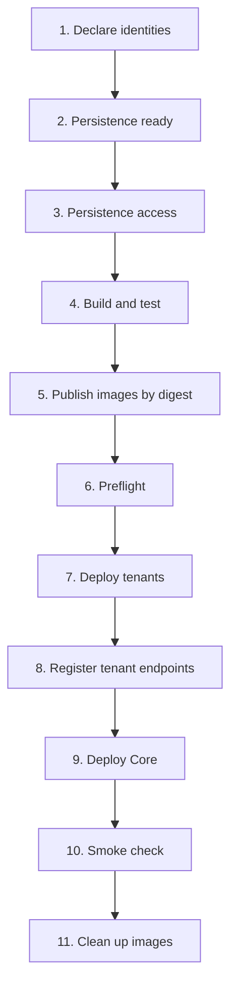

# Order of operations

> Version 1.0 (draft) · Updated 2026-11-21 · Operator path 2 of 4  
> [Previous: Setup and recommended tools](SETUP.md) · [Documentation index](README.md) · [Next: Deployment guide](../deploy/DEPLOYMENT-GUIDE.md)

This page shows what depends on what, so an operator who is new to the platform can do things in an order that does not break it. It summarizes the deployment guides ([deploy](../deploy/DEPLOYMENT-GUIDE.md), [local runbook](../deploy/local/LOCAL-RUNBOOK.md)) and describes the demonstration environment. Another environment keeps the same dependencies and changes the tools.

## The dependency map

## What each step needs, and what breaks without it

| Step | Needs first | If skipped or reordered |
|---|---|---|
| 1. Declare identities | Nothing | Names drift, and the deployer rejects a manifest that does not match the catalog |
| 2. Persistence ready | Step 1 | Core and tenants have nothing to read; the API cannot start cleanly |
| 3. Persistence access | Step 2 | Consumers cannot authenticate; secrets are created before the API, never after |
| 4. Build and test | Step 3 for tests that touch data | Untested code reaches the registry |
| 5. Publish by digest | Step 4 passing | A tag can change under a running service; a digest cannot |
| 6. Preflight | Step 5 evidence | A failed deploy leaves a half-updated system |
| 7. Deploy tenants | Step 6 | Core would register endpoints that do not exist |
| 8. Register endpoints | Step 7 ready | Core routes to a tenant that is not ready |
| 9. Deploy Core | Steps 7 and 8 | Core starts with an empty or wrong route table |
| 10. Smoke check | Step 9 | A broken release is treated as done |
| 11. Clean up | Step 10 passing | Removing images before the smoke check removes the rollback target |

## Rules that keep it safe

- **Core last, data first.** Data and its access path come before anything that reads them. Core comes after the tenants it routes to.
- **Smoke before cleanup.** Image cleanup runs only after the smoke check passes, and never overlaps a release.
- **Keep three images per component:** current, rollback and next.
- **Roll back with the previous digest.** Do not rebuild.
- **Change one layer at a time.** If something breaks, you know which one.
- **Tests belong before deploy, not in it.** Keep the deploy path short: preflight, promote, smoke.

---

[Previous: Setup and recommended tools](SETUP.md) · [Documentation index](README.md) · [Next: Deployment guide](../deploy/DEPLOYMENT-GUIDE.md)
