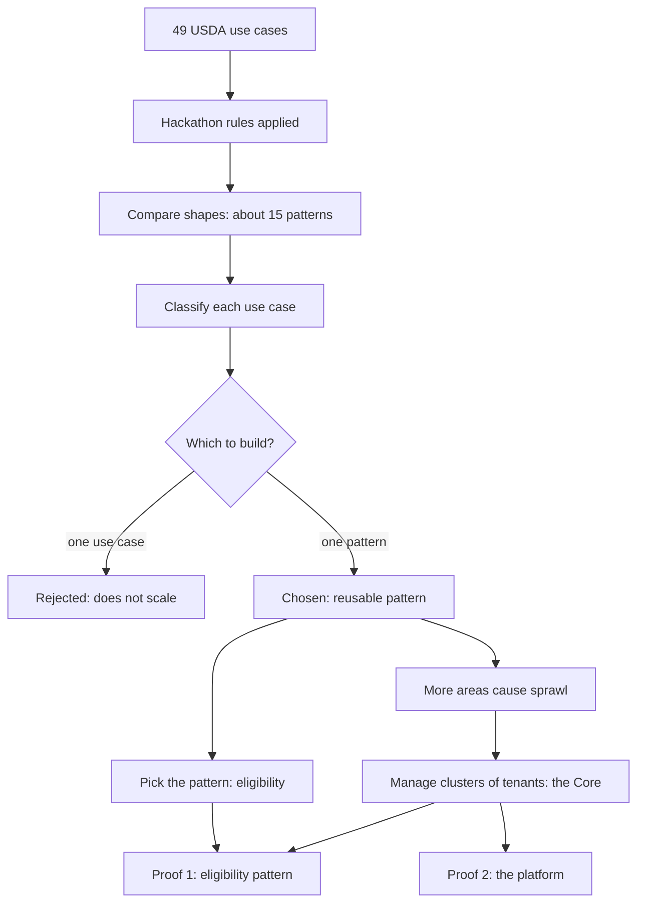
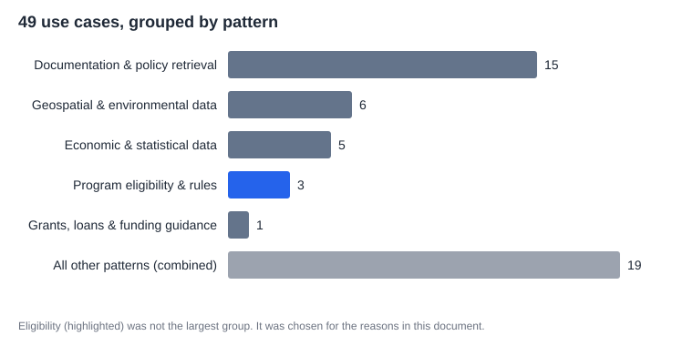

# How the use cases led to the design

> Version 1.0 · Updated 2026-11-21 · Reading order 2 of 7  
> [Previous: Architecture](ARCHITECTURE.md) · [Documentation index](README.md) · [Next: Eligibility pattern](ELIGIBILITY-PATTERN.md)

This document explains how a long list of candidate use cases became one demonstrated pattern (eligibility) and one platform. It is a summary written for this repository. The research it draws on was a working list of 49 USDA use cases that named internal systems and owners, so the list itself is not included. The reasoning and the counts are.

## The path in one picture

## Step by step

1. **Research.** The work started from the question of what makes a good MCP use case. We identified 49 high-value USDA use cases, three for each mission area and staff division.
2. **Apply the hackathon rules.** The hackathon guidelines prohibited production, internal and sensitive data (public data only) and any access to production systems, including writes. That narrowed the list to what could be demonstrated honestly.
3. **Look at the shape of the use cases.** Across all 49, about 15 core patterns appeared. A pattern is a recurring kind of problem, such as retrieving policy documents, serving geospatial layers or checking eligibility. Use cases aligned to patterns one-to-one or many-to-one.
4. **Classify.** Every use case was mapped to its pattern.
5. **Ask which one to build.** Everyone wanted a single answer. The better question was what would happen if we built one pattern well enough to prove it scales.
6. **Face the cost of scale.** As mission areas are added to a pattern, the same tools get rebuilt, governance diverges and the collection of tools grows without management. The answer is to manage a cluster of tenants that share a pattern, and then a set of patterns, each with its own tenants. That is the same model as software as a service, and it is why the platform is a product and a layer rather than one server (see [Architecture](ARCHITECTURE.md)).

## What the counts showed

| Pattern | Use cases |
|---|---|
| Documentation and policy retrieval | 15 |
| Geospatial and environmental data access | 6 |
| Economic, market and statistical data access | 5 |
| Program eligibility and rules retrieval | 3 |
| Grants, loans and funding guidance | 1 |
| All other patterns combined (case and incident retrieval, regulatory and compliance, workforce and HR, scientific publications, drafting, analytics and dataset metadata) | 19 |

Eligibility was not the largest group, and it was not top-ranked by count. Documentation and policy retrieval was the largest by a wide margin, and geospatial and economic data followed. The use case list also scored each case on factors such as expected impact, complexity, tooling and alignment to a mission, and the choice of pattern did not simply follow the highest score.

## Why eligibility anyway

The choice combined the use-case research with an analysis of who the pattern helps. The full argument is in [Eligibility pattern](ELIGIBILITY-PATTERN.md#why-eligibility-was-chosen). In short:

- **The larger groups scale from it.** Documentation retrieval, data discovery and policy analysis are closely related to eligibility and reuse what it builds, so proving eligibility also proves a path to them.
- **It is a two-sided coin.** For the citizen it answers "am I eligible, and do I qualify?" For the applicant it answers the compliance question: is the application complete, correct, aligned to the program goals and competitive?
- **It is a large market.** Public-sector and private-sector organizations alike offer something that not everyone qualifies for, so the same pattern applies well beyond USDA.
- **It reaches the people the programs are for.** Farmers and ranchers are a smaller population than older adults or low-income households, and veterans face similar challenges. Helping more people find the programs that can help them also helps mission-driven organizations serve their communities better, and it connects the mission to the need and the funding to both.

## Two proofs, one demonstration

The demonstration shows two things at once:

| Proof | What it shows |
|---|---|
| The eligibility pattern | A working answer to AI access to public data for everyone: discovery, screening against source-backed criteria and a document binder |
| The platform | A way to run and govern a fleet of such patterns without sprawl: tenants, clusters, routing, approvals and telemetry |

The approach costs little, requires no vendor lock-in and can run independently of a provider, on one provider or across providers.

---

[Previous: Architecture](ARCHITECTURE.md) · [Documentation index](README.md) · [Next: Eligibility pattern](ELIGIBILITY-PATTERN.md)
