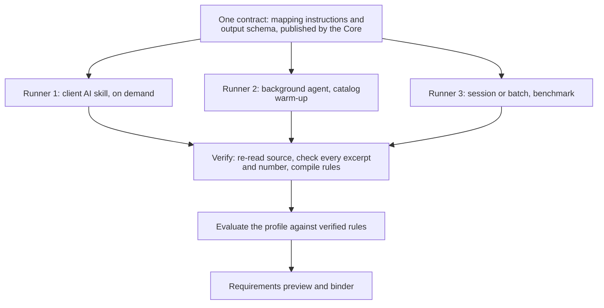

# Criteria mapping

> Version 1.1 · Updated 2026-11-21 · Reference, read after Eligibility pattern  
> [Documentation index](../README.md) · [Related: Eligibility pattern](../ELIGIBILITY-PATTERN.md) · [Provider neutrality](../PROVIDER-NEUTRALITY.md) · [Requirements package](REQUIREMENTS-PACKAGE.md)

## Recommendation: one contract, three runners, one verifier

Use one mapping contract, with three runners and one server-side verifier. The Core publishes the contract (the mapping instructions and the output schema). Any of the three runners can follow it, and the verifier checks whatever they produce.

The three runners do the same job at different times:

1. **The client's own AI (primary).** The person's AI client, whether Claude, an agent platform's eligibility agent, Copilot or the Navigator test client, already has a language model and already reads the source with `program.criteria.source.read`. Mapping there costs the platform nothing and needs no operator. It happens when a person selects a program, which is what the discovery workflow already asks for: normalize the cited criteria, and never let mapping block listing.
2. **A background agent.** It follows the same instructions over the catalog ahead of time, so most programs already have a cached mapping when a person arrives. The instructions are in [`eval/MAPPING-PROMPT.md`](../../eval/MAPPING-PROMPT.md).
3. **A session or a batch job.** It follows the same instructions for benchmarks and regression tests. It reports only and caches nothing.

The verifier is the one new piece the Core needs. A client's mapping cannot be trusted as given, because during testing a client fabricated results. Today `program.candidate.evaluate` reports `independently_revalidated: false`. A single read-only verification operation fixes that: it issues a server receipt proving that each runner's output is traceable and well formed. Whether the meaning is right is tracked separately, by cross-runner agreement and independent expected outcomes. The verifier does not claim it.

A skill alone is not enough, because skills are not enforced and clients vary. A server-side language model alone would put cost and latency on the platform for every request. The skill plus the verifier is the smallest change that works for every client.

## The mapping workflow the Core publishes

The Core publishes a workflow named `request_scoped_criteria_mapping` in its capability map, next to the existing discovery workflow. A client reads it with `read_core_workflow`, and the discovery step that inspects a selected program points to it. Every client receives the same text, so the behavior does not depend on which AI is connected.

It starts when a person selects a listing whose criteria status is `not_assessed` or `mapping_required`, or when a cached mapping is missing or stale. The client then:

1. Reads the source with `program.criteria.source.read`.
2. Maps the clauses by the mapping instructions, binding only to profile fields the schema lists.
3. Sends the result to `program.candidate.criteria.verify`.
4. Fixes or drops anything rejected, with at most one retry.
5. Calls `program.candidate.evaluate` with the verified package and the profile.
6. Calls `program.candidate.requirements.preview`.
7. Shows the score, the unresolved items with their reasons, and the binder.

The workflow forbids inventing a threshold, paraphrasing an excerpt, presenting an unverified mapping as a score, and asking the person to approve a mapping. An item that cannot be resolved stays `partial` with its reason. It never blocks discovery or the binder.

## The verifier

**Status: partly implemented.** The runtime mapper already checks citations against the source text and the active profile schemas, and saves immutable rule sets with exact read-back (`src/clusters/eligibility_mapper.py`, [`eval/MAPPING-PROMPT.md`](../../eval/MAPPING-PROMPT.md)). A standalone read-only verify operation is the planned form described here.

`program.candidate.criteria.verify` would live in the shared Eligibility cluster, exposed the same way as `program.candidate.evaluate`. It takes a criteria package and optional program details, and changes nothing in inventory, profiles or packages. Its only state is the receipt.

### What it checks

The verifier checks structure and traceability, nothing more:

1. It re-reads each cited source through the existing reader and policy, and requires the content hash to match. If it does not, the result is `source_changed`.
2. Every cited excerpt must be an exact substring of the fresh visible text.
3. Every number in a rule must appear in its own excerpt.
4. Every profile attribute must be in the profile schema or the registered extra-attribute vocabulary, and the unit must be supported.
5. The package must compile with the existing criteria compiler.

A pass means the mapping is traceable and well formed. It does not mean the meaning is right. A runner can cite the right sentence and still pick the wrong operator or group alternatives wrongly, so the verifier reports a separate confidence level and never claims correctness.

### The receipt

The client never supplies a hash as proof. A passing check returns a verification receipt issued by the server, carrying a receipt ID, a digest of the exact package and details computed by the server, the source versions, the verifier version, the checks performed, the issue and expiry times, and a signature.

The receipt can be kept in one of two ways. It can be stored by the server and looked up by ID, or it can be stateless, signed with a server-held key so that evaluate can re-check the signature without any storage. Either works. The stateless form needs no table, and its key is a secret held in the hosting environment.

`program.candidate.evaluate` and `program.candidate.requirements.preview` accept the receipt as an option. When one is supplied they recompute the package digest themselves, and check that it matches, that the signature or record is valid, that the receipt has not expired, and that the sources have not changed. Only then do they report `independently_revalidated: true` with the verifier version. Without a receipt, behavior is unchanged.

### Confidence, reported and never asserted

Each score carries the lowest confidence level among the rules it used, and the binder shows that level to the person.

| Level | Meaning |
|---|---|
| `structural_only` | The rule passed the five checks above |
| `cross_runner_agreed` | Two independent runners, for example a client AI and a background agent, produced the same field, operator and value |
| `benchmark_validated` | The runner's version met the accuracy bar on independent expected outcomes for this kind of rule |

If runners disagree, the rule stays `partial` and goes to the backlog job. No operator is needed.

The build is small: one module, a receipt helper, a route binding and tests. A migration is needed only if receipts are stored, and then it is one small table. The checks reuse `eval/mapper/validate_and_run.py` and the source reader in `src/clusters/eligibility_source_reader.py`.

## Measuring accuracy

Execution proves a rule runs. It does not prove the rule is right. For that, the design is a set of per-program reference files holding synthetic profiles with the expected `met`, `unmet` and `unknown` results for each rule and overall. Someone other than the runner under test writes them from the source page: a different model, a person, or the reference set. The benchmark scores every runner against these files, while a runner's own test values only prove the rule executes.

The plan starts with a fixed set of 12 programs and two to three profiles each, including edge values: exactly on the threshold, one over, and a missing fact.

## Which profile attributes a runner may use

A runner may bind a rule only to a listed attribute name. The list is the profile schema's fields plus a Core-published vocabulary of dotted extras, each with a type, allowed values and a meaning. An unlisted name makes the clause `partial` with the reason "no registered profile attribute", and the backlog collects those. Adding a name is a normal vocabulary change, not a per-program approval.

The initial vocabulary is the five extras the reference mappings already use. Until they are registered, the benchmark counts them as pending.

| Name | Type | Used by |
|---|---|---|
| `core.benefits.medicaid_full_benefit` | boolean | Medicare Extra Help (automatic path) |
| `core.benefits.medicare_savings_program` | boolean | Medicare Extra Help (automatic path) |
| `core.benefits.ssi_recipient` | boolean | Medicare Extra Help (automatic path) |
| `core.farm.acreage_report_filed` | boolean | Crop acreage reporting |
| `core.farm.has_fsa_farm_number` | boolean | Crop acreage reporting |

## The portable client skill

A thin skill, `criteria-mapper`, is a draft design that is not included in this package. It is written in the same form as the navigator instructions in [`eval/INSTRUCTIONS-USED.md`](../../eval/INSTRUCTIONS-USED.md). It only tells the client to fetch `request_scoped_criteria_mapping` with `read_core_workflow` and follow it, and it copies none of the rules, so the Core stays the single source. It works in Claude, an agent platform (as instructions), Copilot Studio and the Navigator web chat.

## Where each runner fits

| Situation | Runner | Writes |
|---|---|---|
| A person picks a program in chat | Client AI (runner 1) | Nothing; the work is scoped to the request |
| Catalog warm-up, nightly or after an ingest | Background agent (runner 2) | Caches the verified mapping with the program and source record (a later step) |
| Unknown or partial items | Background backlog job (runner 2, retrying with deeper reading) | The same cache |
| Benchmark and regression | Session or batch (runner 3), reference files | Reports only |

None of these needs an operator approval step. The verifier is the control.

## A platform pattern: publish the work, let the client's AI do it

The Core has no language model, and it does not need one, because every client that connects already brings its own. So the platform publishes workflows, instructions and schemas as data, lets the client's AI do the reasoning, and keeps the deterministic checks on the server. Criteria mapping is the first use. The same pattern fits profile normalization, binder drafting and source triage.

MCP offers three ways to hand work to the client:

| Delivery | How it works | Support | Role |
|---|---|---|---|
| **Workflow in the capability map** (what the Core does now) | The client calls `read_core_workflow` and follows the steps | Any MCP client that can call tools | Primary; works everywhere today |
| **MCP prompts** | The server publishes a named prompt, for example `map_program_criteria`, that the client lists and loads like a skill | Many clients show prompts as slash commands or templates | Planned; a one-click skill with nothing to install |
| **MCP sampling** | The server asks the client to run a model completion during a tool call, with the user's approval, then verifies the result | Uneven across clients | Optional; falls back to the workflow when unsupported |

Four rules hold the pattern together:

- **The Core owns a versioned contract**: the instructions, the schemas and the verifier. Skills and agent files only point to it.
- **The client's AI proposes and the server verifies.** Nothing reaches a score, a write or the shared catalog without passing a deterministic server check.
- **Routine work has no operator gate.** Unresolved items stay in the output with a reason and go to a backlog job.
- **Any runner is interchangeable.** The person's client, a background agent or a batch job all use the same output contract and the same verifier.

## Open items

- The standalone read-only `program.candidate.criteria.verify` operation.
- The mapping workflow entry in the capability map, plus an MCP prompt, `map_program_criteria`.
- Independent expected outcomes for the 12-program set, and a shared vocabulary for extra profile attributes.
- A background-agent run with a benchmark comparison before any full-catalog job.

---

[Documentation index](../README.md) · [Related: Eligibility pattern](../ELIGIBILITY-PATTERN.md) · [Provider neutrality](../PROVIDER-NEUTRALITY.md) · [Requirements package](REQUIREMENTS-PACKAGE.md)
